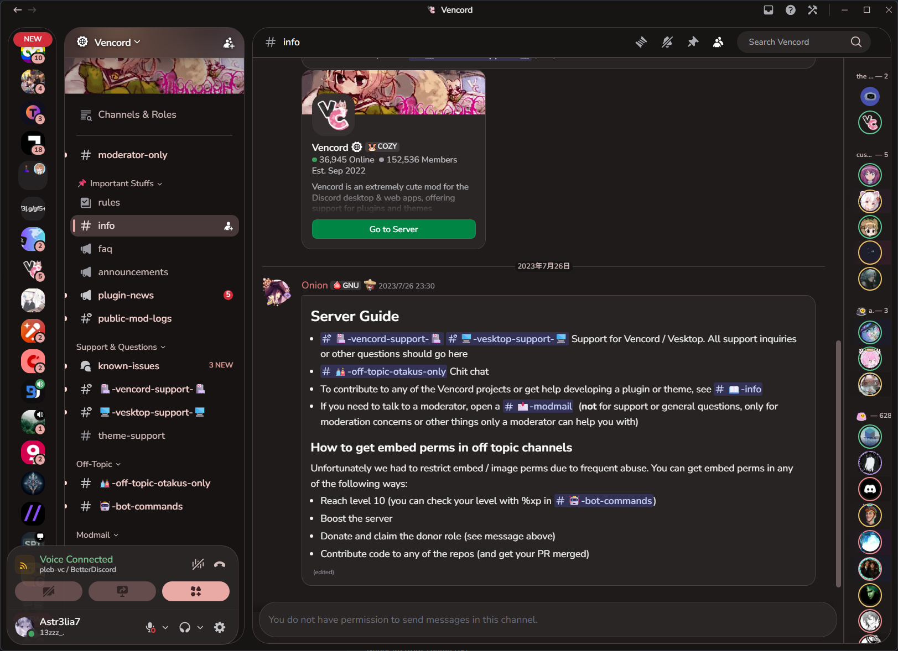
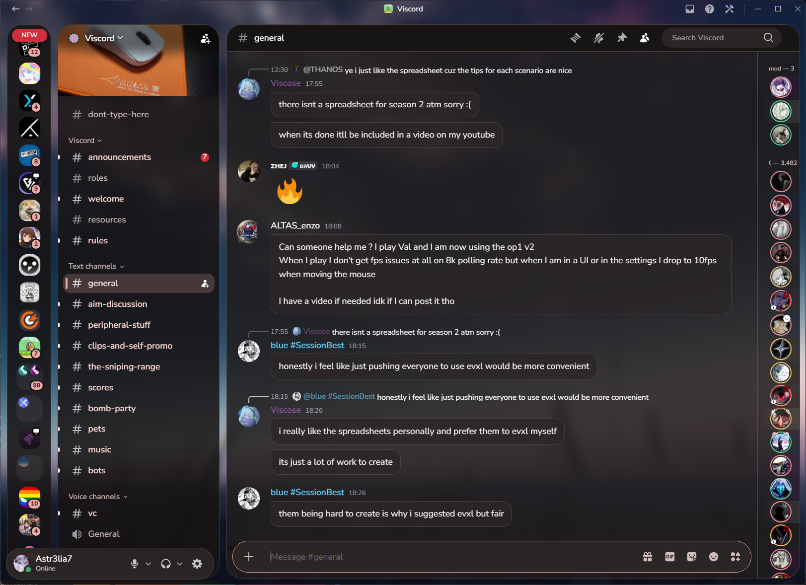
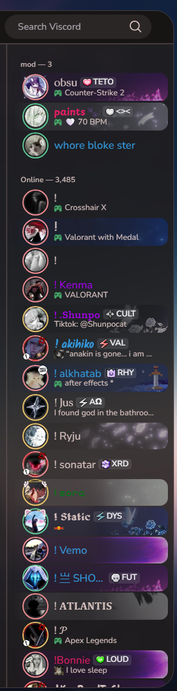

# PixelCord


**Material You, for Discord.** A Pixel-inspired theme by **Miryex** for BetterDiscord and Vencord.

Warm charcoal surfaces, dusty rose accents, rounded panels, customizable wallpaper, message bubbles, and an expandable avatar-only member list with status rings.


## Screenshots

### Server view



### Custom wallpaper and chat bubbles



### Expanded member list



## Customize

Edit the variables near the top of `PixelCord.theme.css`:

```css
--pb-wallpaper: none; /* Flat background by default */
/* --pb-wallpaper: url("https://example.com/wallpaper.jpg"); */
--pb-wallpaper-position: center;
--pb-wallpaper-blur: 10px; /* 0px disables wallpaper blur */
--pb-panel-opacity: 86%;
--pb-gap: 12px;
--pb-members-collapsed: 76px;
--pb-members-expanded: 248px;
```

Use an accessible direct HTTPS image URL or an image data URI. A Windows file path or an image sharing page is not a direct image URL. Wallpaper is optional and is loaded by your Discord client from its host.

The theme follows Discord light/dark mode. Customize the paired `--pb-accent` and `--pb-on-accent` colors in each palette together to maintain readable labels. Code blocks retain a monospace font.

## Fonts and performance

Nunito Sans and Noto Sans SC load from Google Fonts; system fonts are used if unavailable. Remove the opening font `@import` for offline-only use.

A separate wallpaper layer uses a stationary image blur. Panels do **not** use live `backdrop-filter`. No blanket `will-change` or GPU-forcing rules are applied. Member expansion still changes layout; actual performance depends on the Discord build and hardware.
